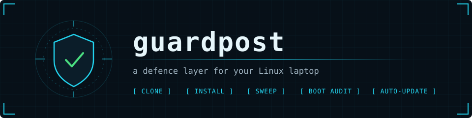
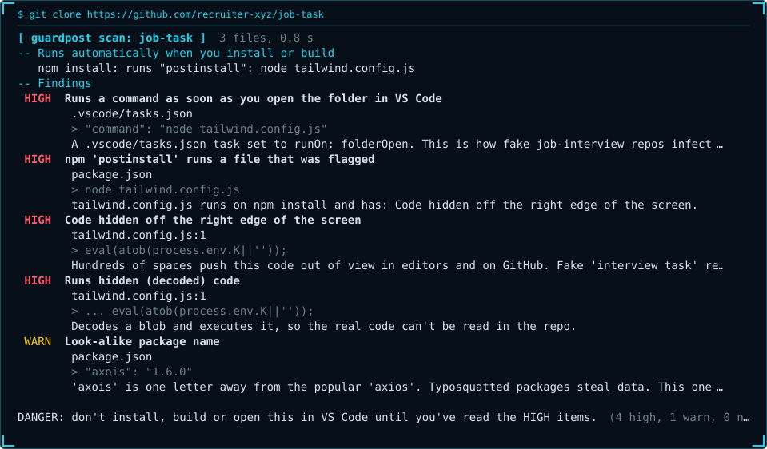
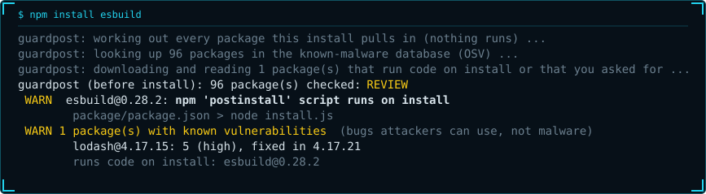
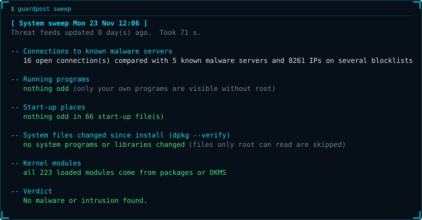

<p align="center"></p>

<p align="center">
<a href="https://github.com/Kumarsujay03/guardpost/actions/workflows/ci.yml"></a>
<a href="https://github.com/Kumarsujay03/guardpost/releases/latest"></a>
<a href="LICENSE"></a>
</p>

**guardpost** is a defence layer for a Linux laptop. It's aimed at developers, who
run code from strangers every day: repos you clone, packages you install, scripts in
fake "job interview" tasks. It needs no root and only the Python standard library, and
it keeps its threat data up to date by itself.

| Layer | When | What it does |
|---|---|---|
| **1. Clone check** | every `git clone` | reads the repo for malware tricks before you open, build or install it |
| **2. Install check** | every `npm/yarn/pnpm/bun install`, `pip install` | checks every package the install pulls in, **before** any of them runs, and again after |
| **3. Weekly sweep** | weekly, by itself | checks everything already on the laptop against fresh threat data, a bit like [MVT](https://github.com/mvt-project/mvt) does for phones |
| **Boot audit** | each login | tells you when the laptop was switched on, who logged in and how, failed attempts, and what changed |
| **Auto-update** | daily, by itself | threat feeds, and new guardpost releases |

## 1. Every `git clone` is checked



A post-checkout hook reads every new clone; nothing in the repo runs. It looks for:

- install hooks that download or run code (npm `postinstall`, `setup.py`, `build.rs`, `curl | sh`)
- **code hidden off the right edge of the screen** behind hundreds of spaces, the way fake interview tasks hide stealers
- `eval`/`exec` of base64 or other encoded blobs, obfuscator output, packed JavaScript
- stealers: code that reads browser passwords, wallets, SSH keys or Discord/Telegram tokens *and* uses the network
- Discord/Telegram webhooks, paste sites and tunnels used to send stolen data out; servers given as bare IPs
- reverse shells, crypto miners, start-up persistence, turning off protections
- VS Code tasks set to `runOn: folderOpen` (they run when you open the folder), dev container `initializeCommand`
- programs inside the source, programs disguised as images, locked zips
- invisible characters: Trojan Source text-direction tricks, zero-width characters, look-alike letters
- look-alike package names (`reqeusts`, `axois`), checked against registry download counts and age
- custom package registries, lockfiles that download from odd servers

The result is **DANGER**, **REVIEW** or **LOOKS CLEAN**. The clone itself always finishes.

## 2. Installs are checked before anything runs, and after



A clean repo can still pull in a malicious package. So when you run `npm install` or
`pip install`, guardpost first works out the **full dependency tree** in a temporary
folder without running anything (`npm --package-lock-only --ignore-scripts`,
`pip install --dry-run --only-binary=:all:`). Then it:

1. looks up every package and version in [OSV](https://osv.dev). That covers known
   **malware** (`MAL-*` entries and hijacked releases such as `ua-parser-js 0.7.29` or
   `ctx 0.2.2`) and known **vulnerabilities**;
2. downloads every package that runs code on install, plus the ones you named,
   checks its checksum and reads it with the clone-check rules. pip wheels are read
   too, including `.pth` files, which run on every Python start;
3. after the install, reads what actually landed in `node_modules` or
   `site-packages` and looks the installed versions up again.

Known malware or a HIGH finding asks **"Install anyway? [y/N]"**. Your own repos (no
remote, or your GitHub account in `trusted_owners`) skip the repo check but still get
the package check. `cargo install` and `make install` get the repo check. To skip once:
`GUARDPOST_OFF=1 npm install`.

## 3. Weekly sweep of what's already installed



`guardpost sweep` runs weekly by itself (a missed run happens at the next login) and
sends a notification:

- **System updates**: packages with security fixes waiting, marked **ACTIVELY EXPLOITED** when the CVE is on CISA's [Known Exploited Vulnerabilities](https://www.cisa.gov/known-exploited-vulnerabilities-catalog) list
- **Installed packages**: every pip (venvs, `~/.local`), npm (project `node_modules`, global) and cargo package checked in OSV for malware and serious bugs
- **Network**: open connections to malware command servers ([abuse.ch](https://abuse.ch) Feodo Tracker, SSLBL) and to IPs on 4+ blocklists ([IPsum](https://github.com/stamparm/ipsum)); `/etc/hosts` redirecting well-known sites
- **Running programs**: started from `/tmp` or `/dev/shm`, deleted their own file, posing as kernel threads; `LD_PRELOAD` and `/etc/ld.so.preload`
- **Start-up places**: autostart entries, services, cron jobs and shell start-up files that run from temp folders or contain download-and-run code
- **System files** changed since their package installed them (`dpkg --verify`), and kernel modules that no package installed
- **YARA and ClamAV** on Downloads, temp folders and start-up folders, when installed (see below)

## Boot audit

About 20 seconds after you log in, a notification says **all clear** or **check your
laptop**. The report lists every power-on and power-off with the time the laptop was
off, recovery boots, power-ons during your quiet hours, boots where nobody logged in,
every login and unlock with its method (password, fingerprint, face, SSH, automatic),
logins by anyone else, failed attempts, wake-ups, USB drives and `sudo` commands. It
also lists what changed since last time: services, timers, cron, autostart, shell
start-up files, PAM, SSH keys, setuid programs, open ports, accounts, admin groups,
extensions and packages. `guardpost boot --last` shows it again.

Linux only sees its own boots. A firmware (BIOS/UEFI) password and disk encryption
cover someone booting another system.

## YARA and ClamAV: do you need them?

Both are optional. guardpost works without them; with them, the weekly sweep and
`guardpost scan` also match known malware *files*.

- **[ClamAV](https://www.clamav.net)** is an open-source antivirus engine. It
  compares files with about 3.6 million signatures of known viruses, trojans and
  other malware. Its own service (`clamav-freshclam`) downloads new signatures
  several times a day.
- **[YARA](https://virustotal.github.io/yara/)** is a pattern-matching tool that
  security researchers use to describe malware families. guardpost downloads
  [Elastic's open Linux malware rules](https://github.com/elastic/protections-artifacts)
  and refreshes them daily.

**Recommended: install both.** They cost nothing when idle and add a second
opinion, especially on what lands in Downloads.

```bash
sudo apt install clamav yara                  # Debian / Ubuntu
sudo dnf install clamav clamav-update yara    # Fedora
```

Loading ClamAV's database takes about 15 seconds, so the quick clone and install
checks use ClamAV only through its background service (`clamav-daemon`, about 1 GB
of RAM). Without that service, ClamAV runs in the weekly sweep and in `guardpost scan`.

## Install

Linux with Python 3.10+ and git. Every check runs on any distribution; the system
update and `dpkg --verify` checks need a Debian-based one. Timers need a systemd
user session (standard on desktop Linux).

```bash
git clone https://github.com/Kumarsujay03/guardpost
cd guardpost
./install.sh
```

Or download `guardpost-<version>.tar.gz` from the
[latest release](https://github.com/Kumarsujay03/guardpost/releases/latest), check it
against the `.sha256`, unpack it and run `./install.sh`. Open a new terminal afterwards.

Everything goes in your home folder:

| | |
|---|---|
| program (one folder per version) | `~/.local/share/guardpost/app/` |
| command | `~/.local/bin/guardpost` |
| settings | `~/.config/guardpost/config.json` |
| reports | `~/.local/state/guardpost/` |
| threat feeds | `~/.local/share/guardpost/feeds/` |

Remove it with `guardpost uninstall`. Reports and settings are kept.

## Updates

A daily timer runs `guardpost update`, which:

1. refreshes the threat feeds (CISA KEV, abuse.ch, IPsum, YARA rules). OSV is
   queried live on every check, so package checks always use the newest data;
2. checks the [latest release](https://github.com/Kumarsujay03/guardpost/releases/latest).
   If it's newer, guardpost downloads it, checks its SHA-256, installs it next to the
   current version and switches over, then sends a notification. If anything fails,
   the old version keeps running.

To get a notification instead of automatic installs, set `"auto_update": false` in
the settings. `guardpost update --check` only checks.

## Commands

```text
guardpost scan [folder | URL | owner/repo] [--all]   check code for malware
guardpost sweep [--last] [--only packages,network]   check what's installed
guardpost boot [--last] [--days N]                   what happened to the laptop
guardpost update [--check]                           feeds and new releases
guardpost uninstall
```

## Settings

`~/.config/guardpost/config.json`:

```json
{
  "quiet_hours": [3, 8],
  "owners": [],
  "trusted_owners": ["your-github-name"],
  "auto_update": true
}
```

`owners` lists the accounts that may log in (empty means you). To sweep every 15 days
or monthly instead of weekly, run `systemctl --user edit guardpost-sweep.timer` and add
the lines below (an override like this survives updates):

```ini
[Timer]
OnCalendar=
OnCalendar=*-*-01,15
```

Use `OnCalendar=monthly` for once a month.

## Privacy

guardpost never uploads your files. It sends only package names and versions (to
osv.dev and the npm/PyPI download-count services) and downloads public feeds and
releases. Reports stay on your laptop.

## Limits

No scanner can prove that code is safe. guardpost reads code; it doesn't run it.
Code built to look harmless, or malware that's too new to be listed, can get through.
A "REVIEW" or "DANGER" result means *read before you run*.

## Contributing

Ideas, new detection rules and fixes are welcome. Fork the repo, make your change on
a branch, and open a pull request. Before you open it, run the tests:

```bash
python3 -I tests/test_scanner.py   # unit tests
```

- New detection patterns go in `guardpost/rules.json`, with a test in
  `tests/test_scanner.py` that shows the pattern catching a sample and not flagging
  normal code.
- Build malicious-looking samples from pieces at test time (see `J([...])` in the
  tests), so the repo itself never looks like malware.
- CI runs the tests, shellcheck and a full install on every pull request.

New versions are published by the maintainer. Installed copies pick them up within a
day.

To report a security problem in guardpost itself, open a
[private security advisory](https://github.com/Kumarsujay03/guardpost/security/advisories/new).

MIT licensed.
